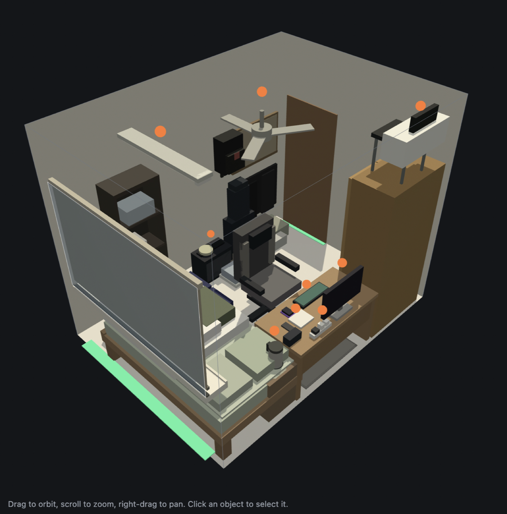
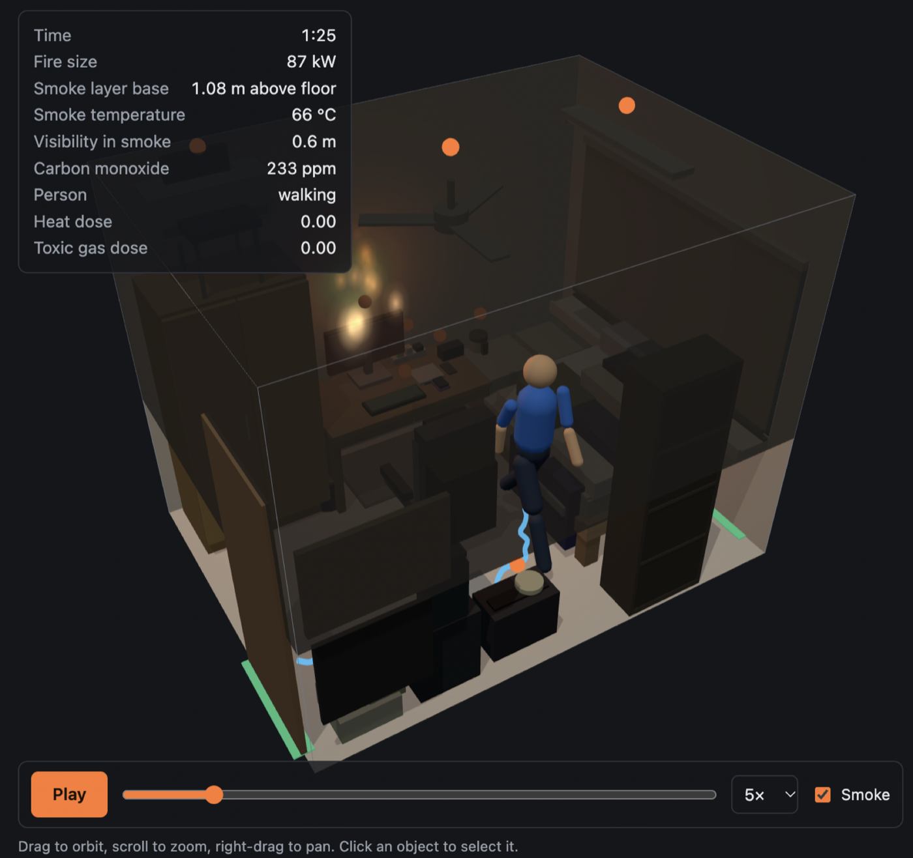
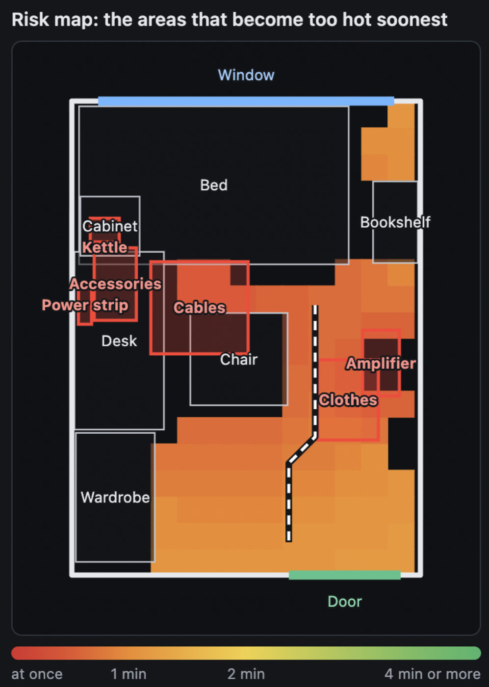
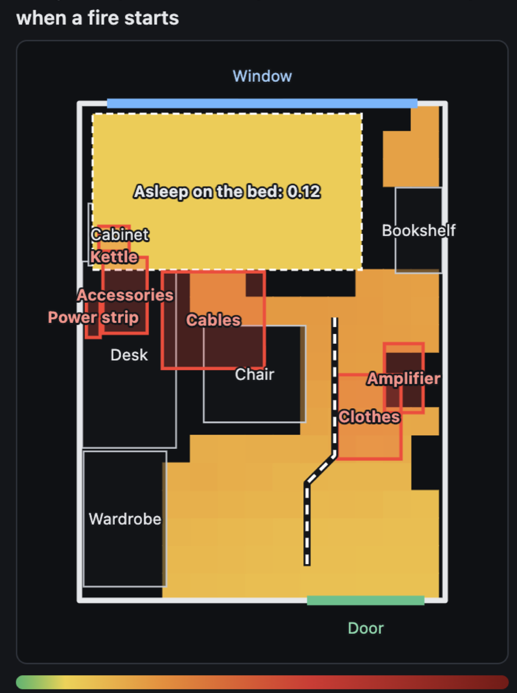

# GTFO: Get the fire out

Film a room with your phone. GTFO builds a 3D model of it, simulates how a fire would
spread and how a person would get out, and shows which items and areas make the room
dangerous, and why.

<p align="center">
  
</p>

It is a working prototype for a single room, built on the way to an iOS app for whole
homes. It is an educational estimate, not a fire safety assessment.

## What it does

**1. Video to 3D room.** Frames from a walkthrough video go to a vision language model,
which returns the room as structured data: floor outline, doors and windows, and every
piece of furniture with its size, position, material and whether it could start a fire.
The browser renders that data. The model never draws anything itself, so the same numbers
feed the simulation.

**2. Fire simulation.** A two-zone fire model, the same family of model used in fire
engineering practice: a hot smoke layer over clean air, items burning on t² growth curves,
spread by radiant heat against standard ignition thresholds, oxygen-limited burning,
window breakage and flashover. The smoke layer temperature is checked against the
McCaffrey, Quintiere and Harkleroad correlation in the test suite.

**3. Escape simulation.** One occupant who notices the fire through a smoke alarm, the
fire's own noise, light or smell, or smoke and heat reaching them; reacts; then makes for
a door around the furniture. They crouch and crawl under smoke, lose their way when they
cannot see, and accumulate a heat and toxic gas dose (ISO 13571) on the way out.

<p align="center">
  
</p>

**4. Risk analysis.** Every likely ignition source is simulated against a sleeper with
and without a smoke alarm and someone awake. The result is a ranked list of risk factors,
a map of where the floor becomes too hot soonest, and a map of how a person at each spot
would fare, averaged over all the fires.

<p align="center">
  
  
</p>

Everything after step 1 is deterministic. The language model describes the room; it never
decides a safety result.

### What it found in the room above

A dorm room of about 2.65 by 3.6 metres, filmed on a phone. Three of thirty simulated
cases ended with the person harmed, all of them sleepers with no smoke alarm. The analysis
picked out the amplifier and the floor cables beside the only route to the door, the
kettle on the bedside cabinet (the fire reaches the mattress in under a minute), and the
missing smoke alarm, which costs the sleeper about 30 seconds of warning on average.

## Running it

Requirements: Python 3.11 or newer, `ffmpeg` and `ffprobe` on the PATH, and an OpenAI API
key for the video step. The viewer, the simulations and the risk analysis all work without
a key using the built-in sample room.

```bash
python3.11 -m venv .venv
.venv/bin/pip install -e ".[dev]"
cp .env.example .env            # add your OPENAI_API_KEY to .env (never committed)
.venv/bin/uvicorn firesim.app:app --reload --port 8000
```

Open http://localhost:8000. Click **Load sample** or upload a video, choose where the fire
starts and where the person is, and click **Run simulation**. **Build risk map** runs the
full analysis and opens the Risk map tab.

A room reconstruction costs roughly US$0.20 in API usage and takes a few minutes. The
simulations run locally in under a second; the risk analysis takes a few seconds, spread
over worker processes.

## Tests

```bash
.venv/bin/pytest
.venv/bin/ruff format . && .venv/bin/ruff check .
```

The suite covers the room schema, frame extraction, the physics relations against known
values, the fire model against the MQH correlation, the escape state machine, and the risk
analysis end to end. It runs on every push through GitHub Actions.

## How it is built

| Path | What it holds |
|---|---|
| `firesim/schema.py` | The `Room` model shared by every stage |
| `firesim/frames.py`, `firesim/reconstruct.py` | Video frames and the structured-output call |
| `firesim/fire/` | Fuel table, physics relations, the smoke layer and the fire run |
| `firesim/escape/` | Walkable grid, dose model and the occupant |
| `firesim/risk.py` | Multi-scenario analysis, floor maps and risk factors |
| `firesim/app.py` | FastAPI routes |
| `web/` | Three.js viewer, procedural animated figure, SVG plans |
| `tests/` | Pytest suite, with `fixtures/sample_room.json` |

The Python package keeps its original name, `firesim`. `CLAUDE.md` documents the
architecture, the coordinate conventions and the reasoning behind each decision.

Stack: Python 3.11, FastAPI, Pydantic v2, the OpenAI Responses API with structured
outputs, and plain JavaScript with Three.js on the front end. No build step.

## Limits

- **One room.** Doors and windows open onto fresh air; the rest of the home is not modelled.
- **Dimensions are estimated from images, not measured.** Typing in a known measurement
  improves the result. Measured capture (AR tracking on the phone) is the planned fix.
- **Fuel properties and human behaviour are literature values and stated assumptions**,
  kept as named constants at the top of `firesim/fire/fuels.py` and
  `firesim/escape/sim.py`, each with a comment on where it comes from.
- **Not modelled:** hydrogen cyanide and irritant gases, smouldering fires, more than one
  occupant, and people who are hard to wake (children, older people, alcohol). Several of
  these make the results optimistic.

## Roadmap

1. Smarter frame selection from the video (sharpness and coverage rather than even spacing).
2. Whole-home simulation: smoke moving between rooms, escape through several of them.
3. "Top three fixes" with measured gains, from re-running with an item moved or removed.
4. iOS capture with AR tracking for real-world scale, and the simple result screens.

See [CONTRIBUTING.md](CONTRIBUTING.md) if you would like to help, in particular with
fire science review or validation.

## Privacy

Video frames are sent to OpenAI to build the room. Uploaded videos, frames and
reconstructed rooms are stored under `data/`, which is ignored by git.

## Licence

MIT. See [LICENSE](LICENSE).

## Author

Shahu Wagh
